<picture>
  <source media="(prefers-color-scheme: dark)" srcset="./profile/banner-dark.svg" />
  
</picture>

### 🌸 About Me

- 🎓 CS undergraduate at **Shanghai Jiao Tong University**, John Class, Zhiyuan College.
- 🔬 Working on **Machine Learning Systems**, mainly **LLM inference & serving**.
- 👀 Also curious about GPU kernels, large-scale training, and ML compilers.
- 🎮 Off the clock: anime (yuri & isekai lately), light novels, games, and trying out every new AI model I can get my hands on.

> [!NOTE]
> The public repos here are mostly **course assignments and small side projects** from my undergrad years.
> My research projects are still in progress — their repos will show up here once the work is complete. 🌱

### 🧰 Tech Stack

  

### 🗂️ What's Here

|     | Area                       | Repos |
| :-: | -------------------------- | ----- |
| 🖥️ | Systems & Architecture     | [xv6](https://github.com/smiling689/xv6) · [CS2951-SystemLabs](https://github.com/smiling689/CS2951-SystemLabs) · [CS61C](https://github.com/smiling689/CS61C-Computer_Architecture) · [RISC-V_CPU](https://github.com/smiling689/RISC-V_CPU) · [RISC-V_Classifier](https://github.com/smiling689/RISC-V_Classifier) |
| ⚡  | Parallel Computing & GPU   | [CS149](https://github.com/smiling689/CS149-Parallel-Computing) · [CS15-418](https://github.com/smiling689/CS15-418-Parallel_Computer_Architecture_and_Programming) |
| 🧠 | AI & ML                    | [CS231n](https://github.com/smiling689/CS231n-Computer-Vision) · [CS50-AI](https://github.com/smiling689/CS50-AI) · [FakeFaceGen-GAN](https://github.com/smiling689/FakeFaceGen-GAN) · [YOLO-TuneEval](https://github.com/smiling689/YOLO-TuneEval) · [Gomoku-AI](https://github.com/smiling689/Gomoku-AI) |
| 📐 | Programming Languages      | [Parser](https://github.com/smiling689/Parser) · [Scheme_interpreter](https://github.com/smiling689/Scheme_interpreter) · [Interval-Scheduling_Monad](https://github.com/smiling689/Interval-Scheduling_Monad) |
| 🧱 | Data Structures in C++     | [BPlusTree](https://github.com/smiling689/BPlusTree) · [Cow_trie](https://github.com/smiling689/Cow_trie) · [Deque](https://github.com/smiling689/Deque) · [LinkedHashMap-LRU](https://github.com/smiling689/LinkedHashMap-LRU) · [Smart_pointers](https://github.com/smiling689/Smart_pointers) · [ESet](https://github.com/smiling689/ESet) |
| 🌐 | Networking                 | [StreamWise](https://github.com/smiling689/StreamWise) |
| 🎲 | Misc & Just for Fun        | [Minivim](https://github.com/smiling689/Minivim) · [GraphViz](https://github.com/smiling689/GraphViz) · [Game-of-life](https://github.com/smiling689/Game-of-life) · [Huawei-Hackathon](https://github.com/smiling689/Huawei-Hackathon) · [Terrain-Generation](https://github.com/smiling689/Terrain-Generation) |

### 📊 Languages & Contributions

  <picture>
    <source media="(prefers-color-scheme: dark)" srcset="./profile/top-langs-dark.svg" />
    
  </picture>

  <picture>
    <source media="(prefers-color-scheme: dark)" srcset="./profile/snake-dark.svg" />
    
  </picture>

